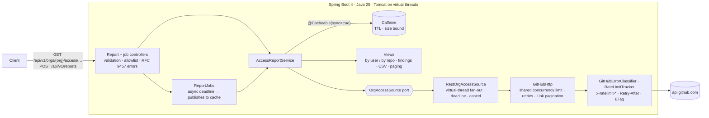

# GitHub Access Report

Shows who can access which repositories in a GitHub organization, **and what the report couldn't
see.**

[](https://github.com/naitikjasani/github-access-report-service/actions/workflows/ci.yml)
· Java 25 · Spring Boot 4.1 · [API errors](docs/errors.md) · [Design decisions](docs/adr/) · [Deploying the demo](docs/deploy.md)

Access reviews ask simple questions: "who are our admins?", "which outside collaborators can push?".
The GitHub REST API answers them one repository at a time. For a large organization that means
over a thousand calls, rate limits, partial failures and pagination. This service makes those
calls safely and caches the result. It answers per user or per repository, and every response says
how complete it is.

## Quick start

```bash
cp .env.example .env            # set GITHUB_TOKEN (fine-grained, read-only; see .env.example)
docker compose up --build
curl -s localhost:8080/api/v1/orgs/<your-org>/access/users | jq
```

Without Docker, run `GITHUB_TOKEN=... ./mvnw spring-boot:run`. Swagger UI is at
`http://localhost:8080/swagger-ui/index.html`.

## Example

`GET /api/v1/orgs/acme/access/users?size=2` against the test fixture organization (trimmed):

```json
{
  "organization": "acme",
  "generatedAt": "2026-10-23T13:17:25.244519Z",
  "ageSeconds": 0,
  "coverage": {
    "complete": false,
    "repositoriesListed": 5,
    "repositoriesReadable": 4,
    "skippedRepositories": [{ "name": "secret", "reason": "INSUFFICIENT_PERMISSION" }],
    "affiliationsKnown": true
  },
  "summary": { "repositories": 4, "users": 4, "outsideCollaborators": 1, "admins": 2 },
  "page": { "number": 0, "size": 2, "totalElements": 4, "totalPages": 2 },
  "items": [
    { "id": 101, "login": "alice", "affiliation": "OWNER",
      "repositories": [{ "name": "api", "permission": "ADMIN", "roleName": "admin", "visibility": "PRIVATE", "archived": false, "fork": false }, "…"] },
    { "id": 201, "login": "bob", "affiliation": "MEMBER",
      "repositories": [{ "name": "web", "permission": "TRIAGE", "roleName": "security-reviewer", "visibility": "PUBLIC", "archived": false, "fork": false }, "…"] }
  ]
}
```

In this example:
- `bob`'s **custom role** keeps its name and maps to its base level (TRIAGE).
- The repository the token couldn't read is **reported** in `coverage`, not silently dropped.

| Endpoint | Returns |
|---|---|
| `GET /api/v1/orgs/{org}/access/users` | each user → their repositories |
| `GET /api/v1/orgs/{org}/access/repositories` | each repository → its collaborators |
| `GET /api/v1/orgs/{org}/access/findings` | access worth reviewing, most severe first |
| `GET /api/v1/orgs/{org}/access/grants.csv` | one CSV row per grant, for spreadsheets |
| `POST /api/v1/reports` → `GET /api/v1/reports/{id}` | asynchronous job for organizations too large for one request |

Filters: `minPermission` (`READ` < `TRIAGE` < `WRITE` < `MAINTAIN` < `ADMIN`), `affiliation`
(`OWNER`, `MEMBER`, `OUTSIDE_COLLABORATOR`), `includeArchived`, `includeForks`. Paging: `page`,
`size` (max 200). For example, *outside collaborators who can push*:
`/access/users?affiliation=OUTSIDE_COLLABORATOR&minPermission=WRITE`.

**Findings** answer "what should we look at?". On the same fixture organization
(`GET …/access/findings`, trimmed):

```json
[
  { "rule": "OUTSIDE_COLLABORATOR_CAN_WRITE", "severity": "MEDIUM", "login": "olga", "repository": "api",
    "permission": "WRITE", "why": "Outside collaborator with WRITE access" },
  { "rule": "ADMIN_ON_ARCHIVED_REPOSITORY", "severity": "LOW", "login": "bob", "repository": "legacy",
    "permission": "ADMIN", "why": "Admin on an archived repository (admins can unarchive it)" }
]
```

The rules:
- Outside collaborators with WRITE or higher (HIGH if ADMIN).
- Non-owner admins on archived repositories.
- Non-owner admins on repositories with no push for `dormantDays` (default 180).

Owners are left out because they are admin everywhere by definition.

**Large organizations:** `POST /api/v1/reports {"organization": "acme"}` returns
`202 Accepted` with a `Location` to poll. The job has a 10-minute deadline. When it has succeeded,
the endpoints above serve its result from cache.

## Architecture



1. **One fetch per organization.**
   - One paginated call lists repositories, and two more list owners and outside collaborators.
   - Then each repository's collaborators are fetched in parallel on virtual threads.
   - At most 8 calls are in flight across *all* reports.
2. **One canonical model.** The result is a flat list of
   `(user, repository, permission, roleName, affiliation)` grants, cached per organization. Both
   views, every filter and every page are derived from that cached object, so changing the query
   never costs another GitHub call.
3. **Every failure has a deliberate outcome.**
   - Transient errors are retried.
   - Rate limits fail fast or wait, depending on which limit was hit.
   - Unreadable repositories are reported.
   - The whole report is bounded by a deadline that cancels outstanding calls.

## Design decisions

| Decision | Why | ADR |
|---|---|---|
| Servlet + virtual threads, not WebFlux | One bounded document per request; same parallelism with plain code, readable traces, easy cancellation | [0001](docs/adr/0001-virtual-threads-over-webflux.md) |
| Classify every GitHub 403 before treating it as "no permission" | Secondary rate limits are also 403s; the first version treated every 403 as "no access", which silently drops repositories under throttling and caches the result | [0002](docs/adr/0002-rate-limits-and-partial-results.md) |
| `coverage.complete` + `skippedRepositories` | An access report that looks complete but isn't is worse than an error | [0002](docs/adr/0002-rate-limits-and-partial-results.md) |
| Caffeine with TTL and `sync=true`, not Redis | One instance, cheap-to-rebuild data; stampede-safe; GitHub load bounded by TTL, not traffic | [0003](docs/adr/0003-caffeine-cache.md) |
| ETag revalidation on every GitHub call | Rebuilding an unchanged report after the TTL is 304s, which GitHub doesn't count against the primary rate limit | [0003](docs/adr/0003-caffeine-cache.md) |
| Async job instead of a longer synchronous timeout | Large organizations shouldn't hold an HTTP connection for minutes; the job publishes into the same cache | [0001](docs/adr/0001-virtual-threads-over-webflux.md) |
| REST + fine-grained token; GraphQL and GitHub App later | Port defined per use case so a batching adapter can drop in; both need a real org to validate | [0004](docs/adr/0004-rest-and-pat-now-graphql-and-github-app-later.md) |

## Failure behaviour

| GitHub condition | Service response |
|---|---|
| 5xx, timeout, dropped connection | retried twice (exponential backoff + jitter), then `502 upstream-unavailable` |
| Secondary rate limit, `Retry-After` ≤ 10 s | waited out, then retried |
| Secondary rate limit, longer | `503 upstream-throttled` + `Retry-After` |
| Primary limit exhausted | `429 rate-limited` + `Retry-After` until reset |
| Quota lower than the report needs | `429 rate-limit-budget`, refused *before* spending it |
| 403/404 on one repository | listed in `coverage.skippedRepositories`; report marked incomplete |
| 401 (bad service token) | `502 upstream-auth-failed`, never our caller's 401 |
| Report slower than 45 s | `504 report-timeout`; outstanding calls cancelled; use `POST /api/v1/reports` |

Every error is an RFC 9457 problem with a stable `code` and a `traceId` that matches the
`X-Trace-Id` header and the server logs. See [docs/errors.md](docs/errors.md).

## Limits and numbers

Every number below says how it was measured.

| What | Value | How |
|---|---|---|
| GitHub requests per report | `ceil(repos/100) + 2 + repos` (+1 per extra collaborator page) | asserted exactly in `LargeOrganizationIT`: 1,214 requests for 1,200 repositories |
| Large-org latency | 25.8 s for 1,200 repos | `LargeOrganizationIT` with `-Dbenchmark.latency-ms=150` (synthetic: WireMock adds 150 ms per call), concurrency 8, Apple M5. The sequential equivalent would be about 182 s. |
| Concurrency bound | ≤ 8 in flight, shared by all reports | `GitHubHttpConcurrencyTest` counts in-flight requests at the server |
| Cache | 10 concurrent requests for one org → 1 GitHub fetch | `CacheIT` |
| GitHub load from the public demo | ≤ 6 reports/hour | 1 allow-listed org × 10-min TTL × `sync=true`, regardless of traffic |
| Docker image | 137 MB compressed (559 MB unpacked); application layer 0.5 MB | `docker save \| gzip \| wc -c`, `docker history` |
| Startup in container | ~2 s | `Started … in 2.015 seconds` in the container logs |
| Rebuild of an unchanged org after TTL | every GitHub call is a 304 (no primary quota) | `ConditionalRequestsIT`: 5 of 5 requests answered 304, identical report |
| Test suite | 128 tests (105 unit, 23 integration), `./mvnw clean verify` ≈ 42 s | Apple M5, warm Maven cache |

**Primary rate limit:** a token allows 5,000 requests per hour, so at most **4 cold reports per hour
for a 1,000-repository organization**. Caching keeps repeat queries free, and ETag revalidation
keeps rebuilds of unchanged data nearly free.

## Security

- **Least-privilege token:** fine-grained, read-only, one organization. *Metadata: read* (repository)
  and *Members: read* (organization). Listing collaborators also requires write access to the
  repository, which an org owner's token has.
- **Allowlist:** `REPORT_ALLOWED_ORGS` returns 403 for anything else, before any GitHub call. This
  is what makes the [public demo](docs/deploy.md) safe.
- **Optional API key:** `REPORT_API_KEY` requires `X-API-Key` on `/api/**`, compared in constant
  time.
- **Secrets never logged:**
  - Config `toString()` masks the token and the key.
  - `LoggingIT` runs success, 401 and 500 paths with DEBUG logging and asserts the token never
    appears.
- **Input validation:** organization names must match GitHub's login rules (400 otherwise).
- **Supply chain:**
  - CodeQL on pushes to `main` and on every PR.
  - Dependency review blocks PRs that add high-severity vulnerabilities.
  - Dependabot for Maven, Actions and Docker.
  - The container runs as non-root on a read-only root filesystem (compose).

## Observability

- **Probes:** `/actuator/health/liveness` and `/actuator/health/readiness`.
  - A `github` health component calls `/rate_limit`, which costs no quota, and is cached for 1 min.
  - It is **excluded from readiness on purpose**: if GitHub is down, the instance can still serve
    cached reports and should stay in rotation.
- **Metrics** at `/actuator/prometheus`:
  - `github_ratelimit_remaining`
  - `github_retries_total`
  - `github_ratelimit_hits_total{type}`
  - `github_conditional_requests_total{result}`
  - `access_report_generation_seconds{outcome,complete}`
  - `cache_gets_total{result}`
  - `http_client_requests_seconds`, tagged by URI *template*, so cardinality stays bounded
- **Logs:**
  - The `prod` profile writes ECS JSON lines.
  - Every line carries `traceId` and `spanId` (Micrometer Tracing, no exporter configured).

## Testing

- **Unit tests:**
  - rate-limit classification (table-driven)
  - `Link` pagination
  - permission and role mapping
  - views, filters and paging
- **Integration tests** (`*IT`, full Spring context against WireMock): every row of the failure
  table, plus:
  - deadline cancellation
  - the budget check
  - cache stampede and TTL
  - a synthetic 1,200-repository organization
  - async jobs (a sync 504 that succeeds as a job)
  - ETag revalidation
  - actuator endpoints
  - log safety
- **Contract test:** parses a real recorded GitHub response (`src/test/resources/github-fixtures/recorded`).
- **No live GitHub calls in CI:**
  - No token is given to the build.
  - The test profile can only target `127.0.0.1`, and a guard test enforces that.
- **Gates in `./mvnw verify`:**
  - ≥ 80% line coverage on the `github` and `report` packages (currently 93.5% overall)
  - palantir-java-format via Spotless
  - `javac -Xlint:all -Werror`

## Known gaps

- **Team versus direct access** isn't distinguished for members: REST can't tell them apart
  cheaply. GraphQL `permissionSources` can (ADR-0004).
- **Dormancy here means the repository's `pushed_at`, not user activity.** User activity needs
  the Enterprise audit log.
- **Single instance:** the report cache, ETag cache and jobs are in-process and lost on restart.
- **Very large organizations:** extrapolating the benchmark, organizations past roughly
  1,600–2,100 repositories at 150–200 ms per GitHub call exceed the 45 s synchronous deadline.
  Those need the async job.
- **The budget check is conservative:** it assumes every call costs quota, so it can refuse a
  rebuild that ETag revalidation would have made almost free.
- **Auth is a personal token:** a GitHub App would give per-installation limits and short-lived
  tokens (ADR-0004).

## Configuration

| Property (env var) | Default | Purpose |
|---|---|---|
| `github.token` (`GITHUB_TOKEN`) | **required** | fine-grained read-only token; startup fails without it |
| `github.max-concurrency` | 8 | GitHub calls in flight across all reports |
| `github.connect-timeout` / `read-timeout` | 5 s / 15 s | per call |
| `github.max-retries` | 2 | transient failures |
| `github.max-retry-after` | 10 s | longest secondary-limit pause waited inside a request |
| `report.sync-deadline` | 45 s | whole-report deadline for synchronous requests |
| `report.async-deadline` | 10 min | deadline for `POST /api/v1/reports` jobs |
| `report.cache-ttl` / `cache-max-size` | 10 min / 100 | cache freshness and bound |
| `report.allowed-orgs` (`REPORT_ALLOWED_ORGS`) | empty (any) | allowlist |
| `report.api-key` (`REPORT_API_KEY`) | empty (off) | require `X-API-Key` on `/api/**` |

## Project layout

```
api/      HTTP layer: report + job controllers, RFC 9457 problems, API key and trace-id filters
report/   use case: service + cache, async jobs, OrgAccessSource port, domain records, views, findings, CSV
github/   GitHub adapter: REST client, transport (limits/retries/pagination), error classifier
config/   typed, validated configuration
```

MIT licensed.
